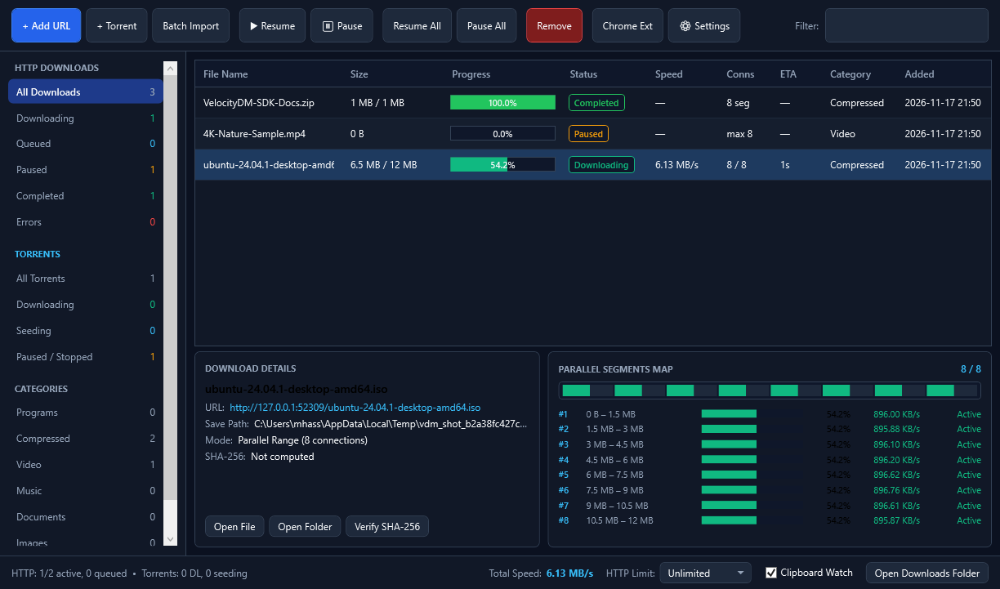
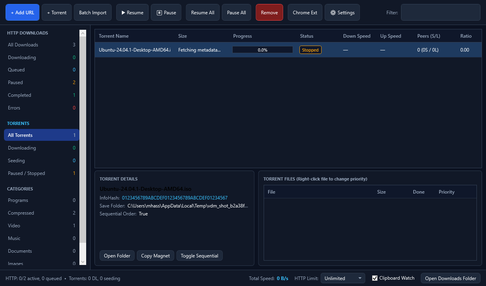
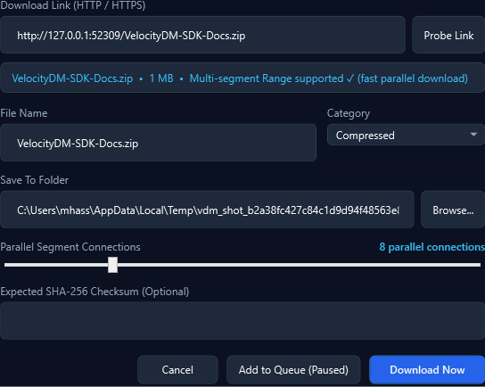
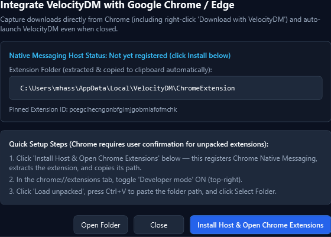

<p align="center">
  
</p>

<h1 align="center">VelocityDM</h1>

<p align="center">
  Native Windows (.NET 8 WPF) multi-segment parallel HTTP &amp; BitTorrent download manager with background System Tray mode and Google Chrome integration.
</p>

<p align="center">
  <a href="https://github.com/sharych/VelocityDM/actions/workflows/ci.yml"></a>
  <a href="https://github.com/sharych/VelocityDM/releases"></a>
  <a href="LICENSE"></a>
</p>

---

## Screenshots

### Multi-Segment Parallel HTTP Downloads
Watch 1–32 parallel byte-range connections download concurrently in the live **Parallel Segments Map**:


### BitTorrent & Magnet Downloads
Manage `.torrent` files and `magnet:?` links with DHT, PEX, sequential streaming mode, and per-file priorities:


### Smart Link Probing & Chrome Extension Integration
<p align="center">
  
  
</p>

---

## Features
- **Multi-Segment Parallel HTTP Downloads (1–32 Connections)**: Splits byte-range-capable downloads into contiguous byte slices written concurrently via `RandomAccess.WriteAsync` into `.vdm.part` files (zero end-of-download merge step), with automatic fallback to single-stream mode when servers ignore `Range` headers or omit `Content-Length`.
- **BitTorrent & Magnet Section (powered by `libtorrent-rasterbar` via LibtorrentSharp — same open-source C++ engine as qBittorrent)**:
  - Add `.torrent` files or `magnet:?xt=urn:btih:...` links (including from clipboard).
  - Supports **uTP (BEP-29) & TCP**, DHT, Peer Exchange (PEX), Local Peer Discovery (LSD), parallel multi-tier tracker announces, **automatic existing-binary hash verification & resume** (matching qBittorrent's check-and-resume workflow plus manual **Force Recheck**), fast-resume persistence, sequential piece ordering, per-file download priorities (`High`, `Normal`, `Low`, `DoNotDownload`), UL/DL rate limits, and optional auto-stop seeding at 100%.
- **Background System Tray Mode (IDM-style)**:
  - Closing the window hides VelocityDM to the Windows System Tray so active HTTP downloads, torrents, clipboard monitor, and the Chrome bridge keep running in the background.
  - Enforces single-instance execution via Mutex + Named Pipe IPC and supports optional Windows startup (`--minimized`).
- **Google Chrome Extension Integration**:
  - Bundled Manifest V3 extension (`extension/chrome/`) intercepts Chrome downloads, forwards `Cookie`, `Referer`, and `User-Agent` headers, adds a `"Download with VelocityDM"` context menu item, and connects via loopback bridge (`127.0.0.1:17890`) and Chrome **Native Messaging Host** (`com.velocitydm.host`) to auto-launch VelocityDM even when closed.
- **Pause, Resume & Crash-Safe Recovery**: Atomically persists HTTP queue, segments, torrents, and settings in `%LOCALAPPDATA%\VelocityDM\`.
- **Batch Link Import & Wildcard Expander**: Supports multi-line URLs and IDM-style ranges like `archive_part[01-10].zip` or `slice_[a-f].bin`.
- **Auto-Categorization & SHA-256 Verification**: Organizes downloads into `Programs`, `Compressed`, `Video`, `Music`, `Documents`, `Images`, `Other`, and `Torrents`, with optional expected SHA-256 checksum verification.

---

## Installation & Trust

Download the latest release from **[GitHub Releases](https://github.com/sharych/VelocityDM/releases)**:

1. **Windows Installer (`VelocityDM-Setup-v2.4.0.exe`)** *(Recommended)*
   - Installs cleanly into `%LocalAppData%\Programs\VelocityDM` with Start Menu / Desktop shortcuts and a Windows Apps & Features uninstaller.
   - Includes a setup checkbox to automatically download & install **Microsoft .NET 8.0 Desktop Runtime (x64)** if it is not already present on your PC.
   - Optionally registers Chrome/Edge Native Messaging, Windows startup, and `.torrent` / `magnet:` associations.
2. **Windows Portable ZIP (`VelocityDM-v2.4.0-win-x64-portable.zip`)**
   - Includes the .NET 8 runtime bundled inside — extract and run `VelocityDM.exe` with no installation required.
3. **macOS DMG (`VelocityDM-v2.4.0-osx-arm64.dmg` / `osx-x64`)**
   - Native macOS Avalonia app (`VelocityDM.app`) with Menu Bar tray mode, Chrome Native Messaging auto-registration, and `Install Chrome Integration.command`.

### Verifying Checksums & Security
Every release is built cleanly on GitHub Actions (`windows-latest`) with SHA-256 checksums (`SHA256SUMS.txt`) and GitHub Build Provenance Attestations. See [SECURITY.md](SECURITY.md) for verification steps, Windows SmartScreen notes, and exact network/registry scope.

## Chrome Extension Setup (One-Time Load)
1. Click **Chrome Ext** in VelocityDM's toolbar and click **Install Host & Open Chrome Extensions** (this registers the Native Messaging Host and copies the extension folder path).
2. In `chrome://extensions`, toggle **Developer mode** ON (top-right).
3. Click **Load unpacked**, paste the copied path (`Ctrl+V`), and select the folder.

## Build & Test from Source

Requires [.NET 8 SDK](https://dotnet.microsoft.com/download/dotnet/8.0) on Windows (and [Inno Setup 6](https://jrsoftware.org/isinfo.php) to compile `installer/VelocityDM.iss`):

```powershell
dotnet build VelocityDM.sln -c Release
dotnet test VelocityDM.sln -c Release --no-build
```

## License
[MIT](LICENSE)
